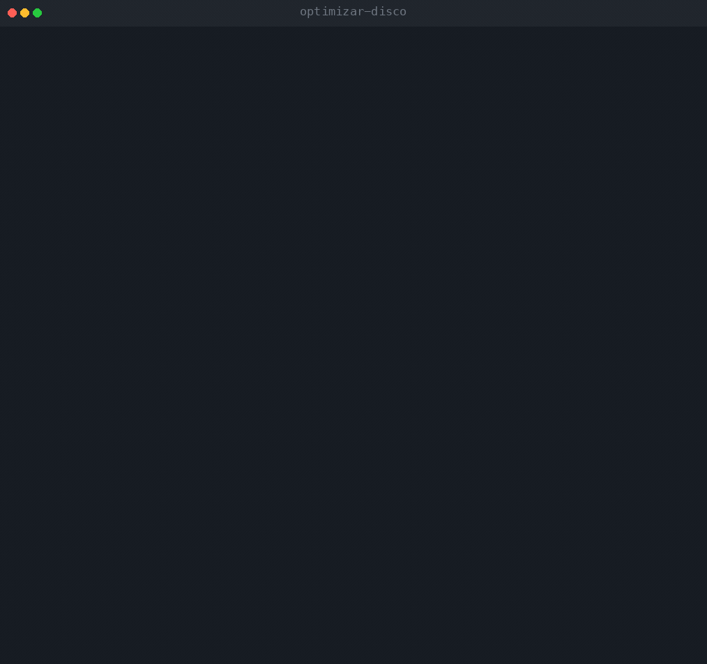
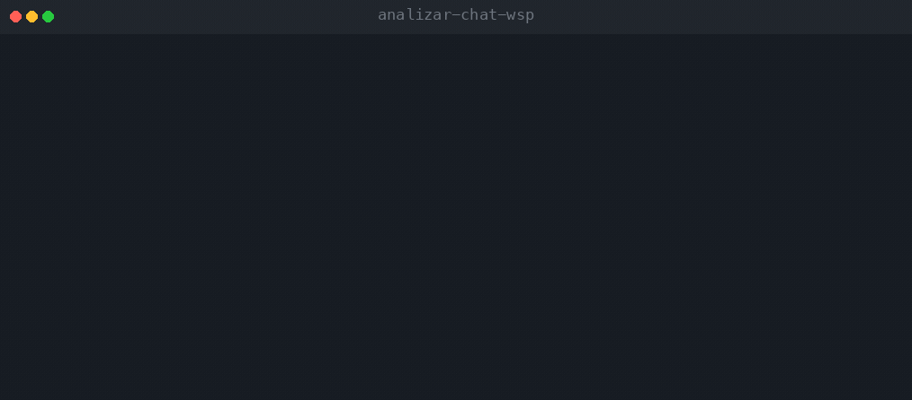

# claude-skills

Tres skills para asistentes de IA de terminal, sacadas de trabajo real y con las reglas duras que
costó aprender escritas adentro.

```bash
git clone https://github.com/tinguinito/claude-skills && cd claude-skills && bash instalar.sh
```

Detecta los asistentes que tengas instalados y se conecta a todos. Reinicia el asistente y listo.

---

## `optimizar-disco` — qué ocupa tu disco, y qué de eso se puede borrar



Un Mac de desarrollo acumula decenas de GB que nadie decidió guardar. En la máquina donde nació
esta skill, con el disco al 93%, el desglose real era:

| Qué era | Cuánto | Por qué estaba ahí |
|---|---|---|
| Modelos de HuggingFace | 13.7 GB | descargados para una prueba, 16 meses antes |
| Modelos de Ollama | 11 GB | cuatro modelos, ninguno usado en meses |
| Cachés de npm | 8.3 GB | `_cacache` + `_npx` |
| `node_modules` de repos inactivos | 5.7 GB | 19 carpetas, la más vieja de 2020 |
| Cachés de VS Code | 4.4 GB | instaladores de extensiones ya instaladas |

**59 GB liberados en una pasada.** Nada de eso lo encuentra "Optimizar almacenamiento" de macOS,
que mira fotos, correo y papelera.

Pero el problema nunca fue borrar. En esa misma máquina había **18 GB en una carpeta que parecía
caché y era la máquina virtual activa de una app**, escrita ese mismo día. Y 1.5 GB de modelos que
se veían idénticos a los otros y eran los que alimentaban las herramientas de transcripción del
usuario. Un limpiador agresivo se los habría llevado.

Por eso la skill **no borra**. Mide, y genera un script de limpieza con las rutas concretas:

```bash
python3 diagnosticar-disco.py --generar limpiar.sh
```

El script generado se lee entero en un minuto, se edita, se pega en otra IA para que lo revise, y
lo ejecutas tú:

```bash
# NODE_MODULES DE REPOS INACTIVOS — 3.3 GB
#    951.5 MB  2026-03-25  ~/proyectos/panel-interno/node_modules
#              último commit del repo: 2026-03-25. Se reinstala con 'npm install'
if confirmar "Eliminar 8 ruta(s), 3.3 GB"; then
  quitar "/Users/usuario/proyectos/panel-interno/node_modules"
```

Y en la cabecera va **lo que decidió no tocar, con la razón de cada exclusión**:

```
# VERIFICADO Y EXCLUIDO al generar este script (NO aparece abajo):
#   ~/Library/Application Support/Claude/vm_bundles
#       contiene una imagen de VM o disco virtual, está en uso
#   ~/proyectos/plataforma/node_modules
#       repo activo, último commit 2026-08-25
```

Excluye solo, sin que lo configures: imágenes de VM (detecta `vmlinuz`, `rootfs.img`,
`Docker.raw`, `*.qcow2`), rutas con un proceso vivo encima, repos con commits recientes y apps
abiertas cuyo caché se reescribiría al vuelo. Lo que creaste tú no se borra: los videos se
*mueven*, avisando que mover dentro del mismo volumen no libera un solo byte.

→ [Informe completo de ejemplo](ejemplos/informe-disco.txt)

---

## `analizar-chat-wsp` — un chat de WhatsApp convertido en documento



Pasas el `.zip` que exporta WhatsApp y sale un dossier en markdown: **las notas de voz y los
videos transcritos localmente** con whisper.cpp, las imágenes y documentos listados con su ruta
para que el asistente los abra con su visión nativa.

```bash
python3 wsp_dossier.py "WhatsApp Chat - Planta.zip" -o dossier-planta.md
```

```markdown
**[08:41:55] Rodrigo Paredes:** 🎙️ _audio_ (`PTT-20260826-WA0001.opus`)

> Hola equipo, les cuento que probamos la báscula nueva en la planta y quedó
> funcionando. El pesaje automático anda bien, pero el ticket sale con la fecha
> del día anterior.
```

Todo corre en tu máquina: ni un audio sale a una API, y las transcripciones se cachean por hash,
así que re-correrlo es gratis.

Las reglas que trae adentro salieron de equivocarse: una transcripción automática **no es un
acta** (antes de citar un precio o un plazo, hay que escuchar el audio), y las fechas relativas de
un chat se resuelven contra la fecha del mensaje, no contra hoy. Eso último ya costó una reunión
perdida: un "mañana tipo 16 hrs" dicho un martes se entendió como jueves.

→ [Dossier completo de ejemplo](ejemplos/dossier-whatsapp.md)

---

## `grabar-demo` — el video de tu producto, escrito como código

Graba cualquier app web con Playwright y la monta con `ffmpeg`: recorta el marco del navegador,
agrega logos, fundidos, aceleración y música.

```bash
node scripts/grabar.mjs demos/panel.mjs --salida grabaciones
scripts/montar.sh --in grabaciones/panel-escritorio.webm --out demo.mp4 --speed 1.6
```

El recorrido vive en un archivo, no en tus manos: cuando la app cambia, lo vuelves a correr y el
video sale igual. Incluye un cursor dibujado (Playwright no graba el puntero, y sin él el video
muestra cosas que cambian sin causa visible), rótulos sobreimpresos, y perfiles de escritorio y
móvil desde el mismo guion.

Dos reglas que no se saltan, ambas aprendidas a golpes:

1. **Nunca se ve el marco del navegador.** Si aparece `localhost:5173`, el video comunica "esto
   corre en el notebook de alguien", no "esto es un producto".
2. **La pista musical se verifica antes de usarla.** Una pista reciclada de otro material puede
   traer locución: `verificar-audio.sh` la transcribe primero. En un caso real, eso evitó que el
   demo de un cliente nombrara a otro.

---

## Instalación

```bash
bash instalar.sh              # symlink en todos los asistentes detectados
bash instalar.sh --copiar     # copia, para un equipo donde el repo no vaya a vivir
bash instalar.sh --verificar  # estado, sin tocar nada
bash instalar.sh --destino ~/mi-agente/skills
```

Destinos que reconoce: `~/.claude/skills`, `~/.agent/skills/skills`, `~/.copilot/skills`,
`~/.gemini/skills`, `~/.codex/skills`.

Por defecto crea symlinks, así que editar una skill acá la actualiza en todos los asistentes a la
vez. Nunca borra lo que encuentre: si ya existe algo con ese nombre, lo respalda fuera del árbol
de skills y avisa dónde quedó.

### Requisitos

| Para | Necesitas |
|---|---|
| `optimizar-disco` | macOS, Python 3.8+ |
| `analizar-chat-wsp` | Python 3.8+, `ffmpeg`, `whisper-cli` con un modelo en `~/.cache/whisper-models/` |
| `grabar-demo` | Node 18+, `ffmpeg`, `npx playwright install chromium` |

Cada skill dice en su `SKILL.md` qué necesita y qué hace si falta.

---

## Cómo está hecha una skill

Una carpeta con un `SKILL.md`: frontmatter con `name` y `description`, y debajo las instrucciones
en markdown. El asistente lee la descripción para decidir cuándo activarla, y ahí carga el resto.
Es texto plano, no un plugin compilado, así que la misma carpeta sirve en cualquier herramienta
que soporte el formato.

Lo que hace útil a una skill no es describir la tarea: es lo que se aprendió haciéndola. Qué
falla, qué hay que verificar antes, qué error ya se cometió y no debe repetirse. En estas tres,
eso está escrito con el caso que lo originó, porque un agente que no sabe por qué existe una regla
la salta en cuanto le estorba.

## Los GIF de este README

Se generan, no se graban. La sesión de terminal vive en un archivo de texto y se renderiza:

```bash
python3 recursos/generar-medios.py recursos/guiones/optimizar-disco.txt --salida media/optimizar-disco
```

Sale el `.gif` para el README, un `.mp4` 16:9 y uno vertical 1080×1920. Grabar la pantalla habría
metido el ancho de ventana, el tema y el prompt con el nombre de la máquina de quien grabó; así
se regenera idéntico cuando la herramienta cambia, y se anonimiza editando texto.

## Licencia

MIT. Ver [LICENSE](LICENSE).
